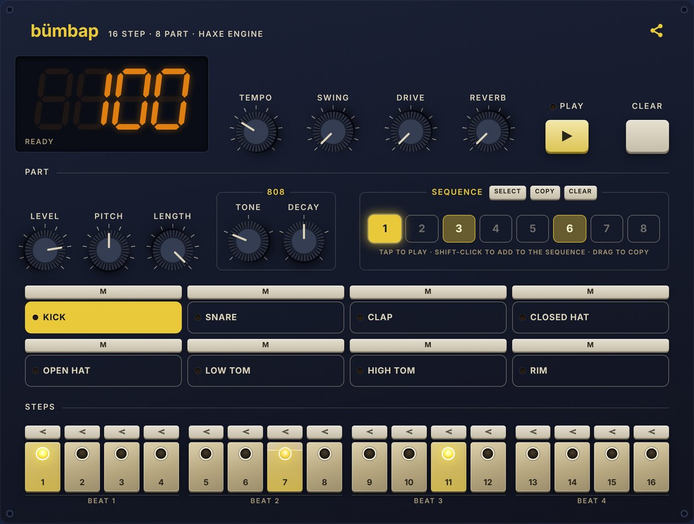

# bümbap

[](https://github.com/tjrhodes/bumbap/actions/workflows/ci.yml)

A playable TR-808 drum machine with one sound engine written in Haxe, and the same front end built
four times: plain DOM code in Haxe, React, Vue and Angular. All four share one stylesheet, one markup
contract and one test suite, so any difference you can measure comes from the framework.

Version 2 adds eight patterns and a sequence to play them in (with Select, Copy and Clear tools), Copy
and Paste for steps, and a Download button that saves the sequence as a loop-ready WAV, and measures
what those new features cost each front end. Version 1 is commit `a28930d`.

**Play it and see the full write-up: [tomrhodes.it/en/work/bumbap](https://tomrhodes.it/en/work/bumbap/)**



## Results at a glance

Headless Chrome; "phone" is a phone-sized window with the CPU slowed four times. Lower is better.
Full tables and how each number was measured: [RESULTS.md](RESULTS.md).

| | Haxe | Vue | Angular | React |
|---|---|---|---|---|
| Code added on top of Tone.js and the engine (min + gzip) | **4.1 kB** | 24.1 kB | 48.1 kB | 65.6 kB |
| Panel on screen, slow 4G phone | **1.9 s** | 4.9 s | 4.9 s | 4.7 s |
| Extra script per playhead step, phone | 0.5 ms | **0.1 ms** | 1.3 ms | 1.9 ms |
| Work per pointer move while dragging, phone | **10.6 ms** | 11.7 ms | 11.0 ms | 13.1 ms |
| Packages installed | **7** | 53 | 218 | 32 |
| Version 2's features: front-end lines added | 114 | **66** | 75 | 105 |

Differences under about 0.5 ms per step or 1 ms per move are run-to-run noise, so Haxe, Vue and Angular
tie on dragging. Plain DOM code is the lightest and quickest to appear, as long as it is written with care: the first Haxe
version was the slowest to drag (21 ms per move), because it rewrote unchanged text on every change
and the browser redid the page layout each time. Frameworks skip that for you. Among the frameworks,
Vue was the lightest and needed the least code, and it needed the fewest lines again to take
version 2's features, most of which went into the shared engine.

## What's here

| Folder | What it holds |
|---|---|
| `engine/` | The shared engine in Haxe: pattern, timing, sound through Tone.js, sharing codes. 276 unit checks. |
| `apps/haxe`, `apps/react`, `apps/vue`, `apps/angular` | The four front ends, each with a `NOTES.md` on how building it went. |
| `shared/` | The one stylesheet every build uses. |
| `tests/` | The Playwright suite run against every build, and the measuring scripts (`tests/measure/`). |
| `prototype/` | The plain-JavaScript prototype the UI was designed in. |
| `samples/` | The TR-808 kit (see Licence below). |
| `SPEC.md`, `RESULTS.md` | The plan and rules; the results and what they mean. |

## Building everything

```sh
tools/build-all.sh     # engine (with its unit tests), the four front ends, the prototype
```

Needs Haxe 4.3 and Node 22.22+ (the Angular CLI's minimum). The CI workflow runs the same
script, then the shared test suite against every build.

## Engine

```sh
cd engine
npm install            # Tone.js, for the smoke test and the front ends
haxe test.hxml         # 276 unit checks on Node with a fake Tone.js
haxe build.hxml        # → dist/drum-engine.js (ES module); types in drum-engine.d.ts
cd .. && python3 engine/smoke/run.py   # real Tone.js + samples in headless Chromium
```

Needs Haxe 4.3 and Node 20+. The smoke test needs Python Playwright.
No Haxe libraries are used.

| File | What it does |
|---|---|
| `src/drum/DrumMachine.hx` | The one object front ends use: edits, play/stop, snapshots, playhead. |
| `src/drum/Track.hx` | One row: steps, volume, mute. |
| `src/drum/Step.hx` | Makes steps (on, velocity, nudge), checked and frozen. |
| `src/drum/PatternCode.hx` | The pattern ↔ short URL code, for sharing (format 5: steps with velocity, nudge and direction, plus each part's sound settings). |
| `src/drum/Timing.hx` | MPC-style swing and per-step nudge. |
| `src/drum/Loudness.hx` | Velocity → gain (85 = part level, 8 points = 3 dB), volume fader → decibels. |
| `src/drum/Kit.hx`, `Limits.hx`, `Range.hx` | The eight voices with their 808 knobs and file naming, the starter beat, every range. |
| `src/drum/Listeners.hx`, `StepRow.hx`, `State.hx` | Subscriptions, `"X..x.o.."` rows, the snapshot types. |
| `src/drum/audio/SampleBank.hx`, `Silence.hx` | One fader per voice; recordings load when first chosen (the last choice wins); reversed copies, silent tail cut first. |
| `src/drum/audio/HitShape.hx` | Pure maths of one hit: pitch as playback rate, length as an early fade, reversed hits ending with their step. |
| `src/drum/audio/MasterChain.hx`, `Saturation.hx` | Headroom → valve overdrive → tone filter → trim → safety clipper, with the reverb as a parallel send. |
| `src/drum/audio/StepClock.hx`, `Latency.hx`, `ToneApi.hx` | The step clock on Tone's transport, playhead drawn when the sound reaches the speaker; a roomier audio buffer against phone crackles; Tone.js types. |
| `src/drum/panel/PanelText.hx`, `SevenSegmentFont.hx` | Words and display text every front end shows, and the LED display's font: shared so the builds cannot drift apart. |
| `drum-engine.d.ts` | TypeScript types, by hand; keep in step with the Haxe API. |
| `tools/to-es-module.mjs` | Turns Haxe's script output into an ES module (runs from build.hxml). |

Tone.js is passed in (`new DrumMachine({tone: Tone, …})`) rather than
imported, so the engine works unchanged in any bundler and the tests can
use a fake.

## House rules

Functions of at most 15 lines, DRY, names that tell the story, comments
that explain why. Check: `python3 tools/check-lengths.py engine samples tools prototype tests apps`
(Haxe, JavaScript, TypeScript, TSX and Vue files).

## Prototype

`prototype/` holds the panel prototype (published as "Bümbap"):
plain JavaScript on the compiled engine, the reference for the UI and the DOM
contract. Build it with `python3 prototype/build.py` after building the engine;
it writes `prototype/drum-preview.html`, which opens straight from disk.

## Samples

The kit is Michael Fischer's free TR-808 sample set (1994); see
`samples/CREDITS.md`. `python3 samples/prepare.py "/path/to/TR808WAV"` copies
every variant of the eight parts (68 files, trimmed; needs numpy), keeping the
set's names (BD2550.wav …). The engine picks the file from each part's 808
knobs (`Kit.hx`) and loads it the first time it is needed.

## Front ends

Each app in `apps/` has its own `NOTES.md` (how it is built, what fought back,
versions). All use `shared/bumbap.css` and the DOM contract in SPEC.md §4.

```sh
cd apps/haxe && haxe build.hxml
cd apps/react && npm install && npm run build      # also apps/vue
cd apps/angular && npm install && npx ng build     # Node 22.22+
```

## Tests and sizes

```sh
cd tests && npm install && npx playwright install chromium
npx playwright test            # 33 tests against every build that exists
node measure-sizes.mjs         # minified + gzipped scripts, per build
node measure/playhead.mjs      # 200 BPM for 30 s: main-thread cost per step, frames, timing
node measure/gestures.mjs      # cost per pointer move dragging a knob and a key
node measure/startup.mjs       # Lighthouse mobile + time until Play is usable on slow 4G
node measure/code.mjs          # UI lines, clean build time, install size (HAXE=…; Node 22.22+)
node measure/tables.mjs        # the tables in RESULTS.md, from measure/results/*.json
```

Each measure runs on desktop and on a phone-sized window with the CPU slowed four times;
`measure/baseline.html` (engine and a bare playhead, no UI) is the floor the builds are compared to.
`node measure/feature-cost.mjs` measures what version 2's feature cost each front end (it needs the
git history). Results and what they mean: [RESULTS.md](RESULTS.md).

| Build | Page scripts | UI + framework (less Tone.js and engine) |
|---|---|---|
| Haxe | 97.7 kB | 4.1 kB |
| Vue | 117.7 kB | 24.1 kB |
| Angular | 141.7 kB | 48.1 kB |
| React | 159.2 kB | 65.6 kB |

Tone.js is 81.0 kB and the engine 12.6 kB in every build.

## On tomrhodes.it

The Lab page plays the four builds side by side (`/en/work/bumbap/`). After building everything and
measuring, copy the builds, the kit and the results into the site:

```sh
python3 tools/export-to-site.py <path to the site folder>
```

The site's own build (`python3 build.py` there) then redraws its charts from the new results. The
exported pages load the site's self-hosted Fira fonts instead of Google Fonts.

## Credits and licence

Design, spec and code rules by Tom Rhodes. The engine and front ends were written with Claude, an AI
coding assistant, to that design, spec and those rules.

The code is MIT licensed (see LICENSE). The drum sounds are Michael Fischer's free TR-808 sample set
(1994) and are not covered by that licence; see `samples/CREDITS.md`.
